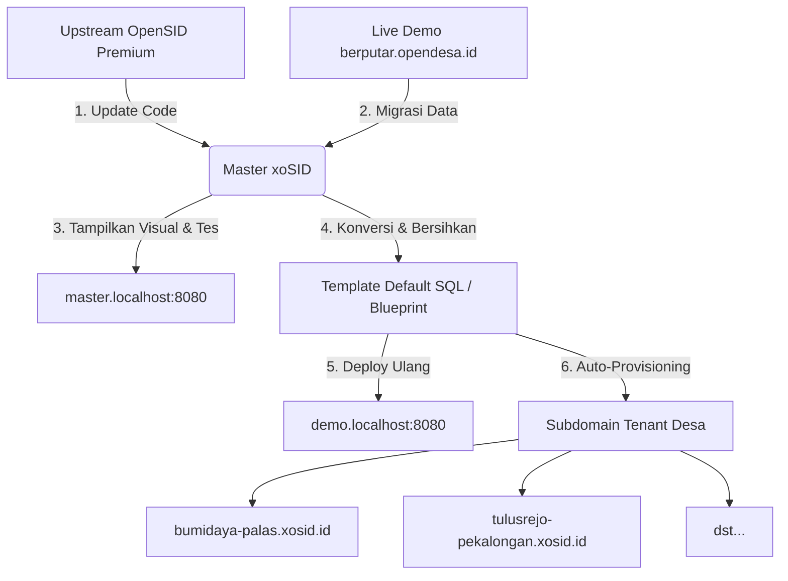

# Panduan Arsitektur & Siklus Pemeliharaan XOSID (SaaS OpenSID Supradesa)

Dokumen ini menjelaskan arsitektur multi-tenant XOSID, pembagian komponen sistem, dan siklus pembaruan rutin bulanan untuk menjaga stabilitas platform SaaS.

---

## 1. Komponen Utama Sistem

Alur kerja platform XOSID dibagi menjadi 4 komponen utama yang terpisah secara database namun terhubung dalam satu sistem kode terintegrasi:

### A. Master xoSID (Core Engine)
* **Database**: `xosid` (Database Master)
* **Visualisasi / URL**: `http://master.localhost:8080` (Lokal) atau `http://master.xosid.id` (Produksi)
* **Deskripsi**: 
  Merupakan basis rujukan utama seluruh platform. Database ini berisi gabungan struktur tabel terbaru dari OpenSID Premium dan data contoh/demo ter-update hasil migrasi/scrape dari live demo target (`https://berputar.opendesa.id`).
* **Aturan Proteksi**: 
  Database ini **tidak boleh diubah konfigurasinya secara manual** untuk kepentingan kustomisasi fitur tenant. Perubahan kode inti diatur melalui file proteksi `.xosid_protected` agar pembaruan upstream tidak menimpa kustomisasi SaaS.

### B. Template Default xoSID Supradesa (Blueprint)
* **Wujud Fisik**: Berkas dump SQL `xosid_neural_fully_restored_20260512.sql`
* **Deskripsi**: 
  Cetak biru database bersih yang digunakan untuk kloning otomatis saat desa baru mendaftar.
* **Proses Konversi**: 
  Sistem mengambil dump dari *Master xoSID*, lalu mengondisikan (membersihkan) data identitas desa pada tabel `config` agar kembali ke nilai default (Desa Bumi Daya, Kec. Palas, Kab. Lampung Selatan) serta menghapus log/session sementara yang tidak diperlukan.
* **Pengembangan Fitur**: 
  Segala bentuk penyesuaian visual default, tema (aktif menggunakan `neural-fundamental`), maupun struktur kolom bawaan platform XOSID dipersiapkan di dalam template ini.

### C. Subdomain Uji Coba (Demo Site)
* **Database**: `xosid_tenant_demo`
* **Visualisasi / URL**: `http://demo.localhost:8080` (Lokal) atau `http://demo.xosid.id` (Produksi)
* **Deskripsi**: 
  Situs percontohan interaktif bagi calon pengguna yang ingin mencoba dasbor desa versi terbaru sebelum mendaftar. Database ini diperbarui (di-deploy ulang) secara berkala menggunakan *Template Default xoSID* terbaru.

### D. Subdomain Tenant Desa (Auto-Provisioning)
* **Database**: `xosid_tenant_[subdomain]` (misal: `xosid_tenant_bumidaya-palas`)
* **Visualisasi / URL**: `http://[nama_desa]-[kecamatan].xosid.id`
* **Deskripsi**: 
  Website operasional mandiri masing-masing desa pelanggan yang disetujui. Sistem secara otomatis membuat database baru, mengimpor *Template Default xoSID*, dan menyuntikkan identitas wilayah riil desa tersebut saat persetujuan registrasi oleh Superadmin.

---

## 2. Siklus Pemeliharaan Bulanan (Rutin)

Setiap awal bulan (ketika OpenSID Premium merilis pembaruan versi resmi di GitHub), Superadmin menjalankan siklus berikut:

1. **Unduh & Perbarui Kode Upstream**:
   Superadmin mengakses menu *Pembaruan Sistem* untuk mengunduh kode terbaru dari GitHub rilis premium. Sistem melakukan *diff analysis* dan menerapkan pembaruan tanpa merusak file kustomisasi SaaS (mematuhi aturan `.xosid_protected`).
2. **Sinkronisasi Data Demo Terbaru**:
   Menggunakan menu *Migrasi (Smart Bridge)* dengan metode *Magic Move* dari target demo `https://berputar.opendesa.id` untuk memperbarui database master `xosid` lokal dengan struktur dan data contoh terbaru.
3. **Validasi Visual Master**:
   Superadmin memeriksa dan menguji kestabilan sistem secara langsung di `http://master.localhost:8080` untuk memastikan pembaruan kode dan migrasi berjalan sempurna.
4. **Cetak Template Default (Blueprint)**:
   Melalui menu *Template & Uji Coba*, Superadmin mengekspor basis data master yang sudah divalidasi ke berkas SQL template default. Identitas wilayah dibersihkan secara otomatis.
5. **Deploy Subdomain Demo**:
   Memublikasikan template default terbaru ke `demo.localhost:8080` agar situs uji coba publik selalu mencerminkan versi termutakhir.
6. **Kloning Siap Digunakan**:
   Pendaftaran baru otomatis akan menggunakan template database terbaru yang sudah bersih dan mutakhir.

---

## 3. Konfigurasi Routing Subdomain

Konfigurasi koneksi multi-tenant diatur secara dinamis pada [desa/config/database.php](file:///Users/kampungjagoan/Downloads/XOSID/desa/config/database.php) dengan aturan resolusi host berikut:

| Host / Subdomain | Database Terhubung | Keterangan |
|---|---|---|
| `localhost:8080`   `xosid.id`   `www.xosid.id` | `xosid` | Portal Landing Page Utama SaaS |
| `master.localhost:8080`   `master.xosid.id` | `xosid` | Portal Visual Uji Coba Database Master |
| `demo.localhost:8080`   `demo.xosid.id` | `xosid_tenant_demo` | Portal Demo Interaktif Publik |
| `[subdomain].localhost:8080`   `[subdomain].xosid.id` | `xosid_tenant_[subdomain]` | Portal Operasional Desa Pelanggan |
